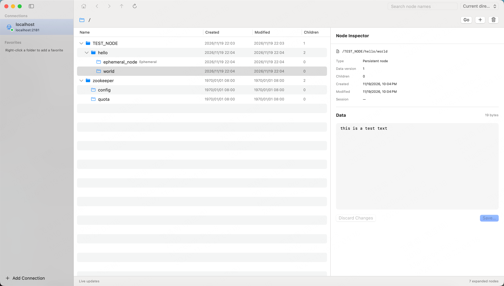

# ZooDirector

English | [简体中文](README.zh-CN.md)

A native macOS ZooKeeper client with a Finder-style interface, built with Swift, SwiftUI, and AppKit. No JVM or WebView dependencies.



## Features

- Multiple connections, connection testing, digest authentication, and SSH tunnels, with independent browsing and editing state for each connection.
- Tree browsing without pagination, path navigation, favorites, and column sorting.
- Node data, creation and modification times, child counts, and ephemeral node indicators.
- Search the current directory or include subdirectories; current-directory results remain expandable and collapsible.
- Text editing, persistent and ephemeral node creation, multiple selection, and confirmation for recursive deletion.
- Live Watch updates, with one-time watches for ZooKeeper 3.4 / 3.5 and persistent watches for 3.6+.
- English and Simplified Chinese interfaces, selectable in Settings.

## Build and Run

Requires macOS 14+ and Xcode or a Swift toolchain with the macOS SDK. Verified on Apple Silicon with Swift 6.4.2.

```sh
git clone git@github.com:ssfyn/zoo-director.git
cd zoo-director
./scripts/build-app.sh
open ".build/ZooDirector.app"
```

Use `./scripts/build-app.sh debug` for a development build, or open `Package.swift` in Xcode.

Builds update the same app bundle. Restart the app to load changes. The build produces an ad hoc signed app for the local architecture; it is not notarized. Bundle identifier: `fan.yanan.zoodirector`.

## Usage

Add a connection using `host:port`, then click **Connect** to browse. Enter an absolute path in the address bar, double-click a node to enter it, or double-click `..` to go up one level.

Click `+` to create a node, or select a node to edit its data in the inspector. Use `⌘`-click or `Shift`-click to select multiple nodes, then click the trash button to delete them. Nonempty nodes require **Delete all child nodes as well**. With digest enabled, new nodes are accessible only to the current authenticated identity; otherwise, they use the open `world:anyone` ACL. Batch deletion stops at the first failure, and completed deletions are not rolled back.

digest usernames are stored in connection settings; passwords are stored in macOS Keychain. Leave the password unchanged when editing to keep the saved password. Connection testing confirms that the identity was submitted; actual access depends on each node's ACL. digest does not encrypt traffic and can be combined with an SSH tunnel.

SSH supports key authentication only. The ZooKeeper address must be reachable from the SSH server. Connect from a terminal and verify the SSH host fingerprint before first use; add encrypted private keys to ssh-agent beforehand.

Common shortcuts: `⌘N` add a connection, `⇧⌘G` focus the path bar, `⌘R` refresh, `⇧⌘N` create a node, `⌘⌫` delete selected nodes, `⌘S` save, and `⌘,` open Settings.

## Limitations

- SASL, TLS, chroot, cluster failover, automatic reconnection, and ACL editing are not supported.
- Search matches node names only. Recursive searches have scan and result limits, with a notice when a limit is reached.
- Non-UTF-8 data and content larger than 256 KiB have read-only previews. Writes are limited to 1,000,000 bytes.
- Saves check the data version, and writes are not retried automatically. Refresh to confirm the result after a network error.
- All names in the current directory are loaded, while metadata is fetched on demand. Very large directories still consume memory accordingly.

## Tests

```sh
swift test --disable-sandbox
```

Tests requiring a real server are skipped unless configured. Setting `ZOODIRECTOR_TEST_ENDPOINT` enables actual read/write tests: use an isolated instance with a writable `/zoodirector-test` node created in advance.

See [docs/validation.md](docs/validation.md) for validation records (in Chinese).
