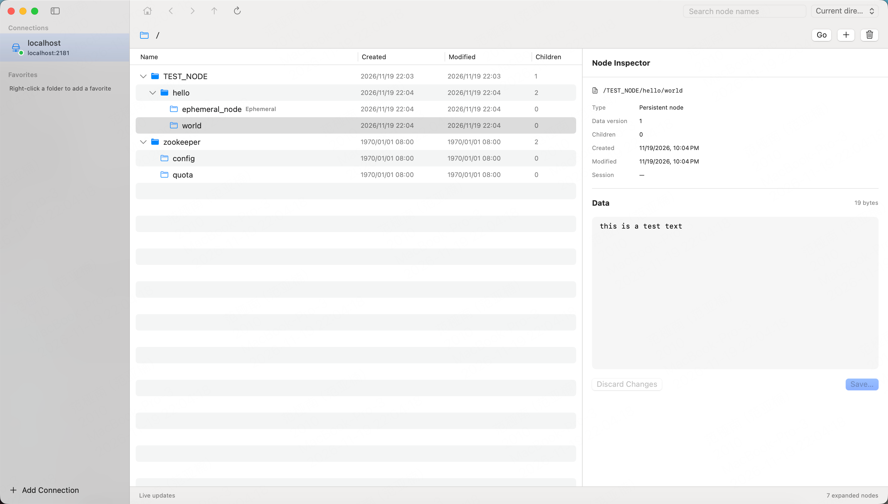

# ZooDirector

[English](README.md) | 简体中文

Finder 风格的 macOS 原生 ZooKeeper 客户端，使用 Swift、SwiftUI 和 AppKit 构建，无 JVM 或 WebView 依赖。



## 功能

- 多连接管理、连接测试、digest 认证和 SSH 隧道，各连接独立保留浏览与编辑状态。
- 树状浏览，无分页展示当前层节点；支持路径跳转、收藏和列排序。
- 查看节点内容、创建时间、修改时间、子节点数及临时节点信息。
- 搜索当前目录或包含子目录；当前目录筛选保留展开与收起操作。
- 编辑文本、创建持久／临时节点、多选删除及递归删除确认。
- Watch 实时刷新，兼容 ZooKeeper 3.4 / 3.5 单次监听与 3.6+ 持久监听。
- 简体中文与英文界面，可在首选项中切换。

## 构建运行

需要 macOS 14+、Xcode 或包含 macOS SDK 的 Swift 工具链。已在 Apple Silicon、Swift 6.4.2 下验证。

```sh
git clone git@github.com:ssfyn/zoo-director.git
cd zoo-director
./scripts/build-app.sh
open ".build/ZooDirector.app"
```

开发构建使用 `./scripts/build-app.sh debug`，也可用 Xcode 打开 `Package.swift`。可通过第二个参数指定架构，例如 `./scripts/build-app.sh release x86_64` 或 `./scripts/build-app.sh release universal`；指定架构时应用输出到 `.build/apps/架构/ZooDirector.app`，不覆盖日常开发应用。

构建始终覆盖同一个应用包，重启应用后加载更新。默认生成本机架构、已启用 App Sandbox 的临时签名应用，尚未公证。应用标识为 `fan.yanan.zoodirector`。商店与自行分发统一使用沙箱和相同业务功能，权限与验证说明见 [沙箱适配](docs/sandbox.md)。

## GitHub Actions

发布 Release 后自动生成已签名、公证的 ARM 与 Intel DMG。本地“关于”默认显示 `dev`，Release 包使用标签版本及构建号。先按 [发布指南](docs/releases.md) 配置六个仓库 Secrets；不可变 Release 采用先手动构建草稿再发布的方式。

## 签名、公证与分发

Mac App Store 打包使用 `APP_VERSION=1.0.0 ./scripts/build-appstore.sh`，生成 Universal 商店安装包，构建号根据本机记录自动递增，也可通过 `BUILD_NUMBER` 手动覆盖；随后使用 `scripts/upload-appstore.sh` 校验或显式上传，不自动提交审核。证书、可选描述文件和认证配置见 [商店发布指南](docs/appstore.md)。以下流程用于自行分发。

正式发布使用 `scripts/release-app.sh`，需要已生效的 Apple Developer Program 会员、本机钥匙串中的 Developer ID Application 证书及对应私钥，以及包含 `notarytool`、`stapler` 的 Xcode 工具。签名和公证需要网络。

首次使用先将公证凭据存入钥匙串，按提示输入账号、Team ID 和 App 专用密码；使用账号认证时，API 私钥路径留空：

```sh
xcrun notarytool store-credentials "zoodirector-notary"
security find-identity -v -p codesigning
```

从第二条命令的输出中复制自己的 Developer ID Application 完整名称或 SHA-1，写入本机的 `scripts/.env`，避免误用其他团队证书：

```sh
SIGNING_IDENTITY="Developer ID Application: 你的姓名 (TEAMID)"
NOTARY_PROFILE="zoodirector-notary"
```

本机的构建和发布 shell 脚本启动时都会检查该文件，存在时按 shell 语法加载并导出变量，供当前脚本及子进程使用；文件中的赋值覆盖已有同名环境变量。含空格的值需要引号。该文件已被 Git 忽略，新克隆仓库时需要自行创建；不存在时仍可使用环境变量配置。GitHub Actions 忽略该文件，仅使用工作流参数与 Secrets。

配置后直接运行：

```sh
APP_VERSION=1.0.0 ./scripts/release-app.sh
```

脚本先检查签名身份及公证凭据，默认依次生成三个正式产物：

- `dist/ZooDirector-版本号-arm64.dmg`：Apple Silicon 版本。
- `dist/ZooDirector-版本号-x86_64.dmg`：Intel 版本。
- `dist/ZooDirector-版本号-universal.app`：同时包含两种架构的通用应用。

每个应用均先核对架构、从内到外签名辅助程序与主应用，保留共用 App Sandbox 权限并启用 Hardened Runtime，再公证、附加票据并验证。Universal 应用的主程序和 SSH 授权辅助程序均通过 `lipo` 合并两种架构，资源必须一致，合并后重新签名、公证。DMG 包含已附加票据的应用及指向 `/Applications` 的快捷方式，DMG 自身也会签名、公证、附加票据并验证。ZIP 仅作为工作目录中的临时公证上传文件，不作为最终发布产物。默认流程共提交五次公证。

三个产物均要求 macOS 14+；每次重新构建后都需重新签名、公证。交叉编译不需要运行目标架构程序，Intel 版及 Universal 应用的 Intel 架构仍应在 Intel Mac 上验证。

只生成一种产物时，执行 `APP_VERSION=1.0.0 ./scripts/release-app.sh arm64`、`APP_VERSION=1.0.0 ./scripts/release-app.sh x86_64` 或 `APP_VERSION=1.0.0 ./scripts/release-app.sh universal`。每种产物使用独立工作目录和公证记录；任何步骤失败都会停止后续步骤，已成功生成的其他产物会保留。

凭据名称默认是 `zoodirector-notary`，可通过 `NOTARY_PROFILE` 覆盖。使用 `./scripts/release-app.sh --help` 查看说明。公证可能耗时较长；失败时会在 `dist/.release.*` 保留提交结果、工作文件和可获取的诊断日志。上传成功后即使等待中断，苹果仍可能继续处理，可用提交编号执行 `xcrun notarytool info 编号 --keychain-profile zoodirector-notary` 查询。重复发布成功会覆盖同版本、同架构的产物；验证失败不会替换已有产物。旧流程生成的 ZIP 不会自动删除。

`dist/` 已被 Git 忽略。脚本只引用钥匙串凭据名称，不包含密码或私钥；不要将 App 专用密码、`.p8` 或含私钥的 `.p12` 文件提交到仓库。公证流程参考[苹果官方文档](https://developer.apple.com/documentation/security/customizing-the-notarization-workflow)。

## 使用

添加 `host:port` 格式的连接后，点击“连接”进入浏览。地址栏支持绝对路径；双击节点进入，双击 `..` 返回上一级。

点击 `+` 新增节点，选中节点后在检查器编辑。使用 `⌘` 点选或 `Shift` 连选，再点击垃圾桶删除；非空目录需勾选“同时删除所有子节点”。启用 digest 时，新节点仅允许当前认证身份访问；未启用时使用 `world:anyone` 开放权限。批量删除逐个执行，失败即停止，已删除内容不会回滚。

digest 用户名保存在连接配置中，密码保存在 macOS 钥匙串；编辑时不修改密码即可保留原密码。测试连接确认身份提交成功，实际读写权限由节点 ACL 决定。digest 不加密网络传输，可配合 SSH 隧道。

SSH 使用明确选择的私钥认证，ZooKeeper 地址需为 SSH 服务器可达的地址。私钥通过文件选择框授权并保存只读书签，加密私钥在连接时弹窗输入口令，口令不会保存。首次连接需核对弹窗中的服务器指纹；信任记录由应用独立保存，服务器换钥后可在连接设置中使用“忘记服务器信任记录”，核实后重新连接。两种分发渠道均不再自动读取默认私钥、系统 `ssh-agent` 或 `~/.ssh/known_hosts`。旧 SSH 配置首次使用需重新选择私钥。

常用快捷键：`⌘N` 添加连接、`⇧⌘G` 跳转路径、`⌘R` 刷新、`⇧⌘N` 新增节点、`⌘⌫` 删除所选节点、`⌘S` 保存、`⌘,` 首选项。

## 当前限制

- 不支持 SASL、TLS、chroot、集群故障切换、自动重连和 ACL 编辑。
- 搜索仅按节点名称；递归搜索有扫描与结果数量上限，达到时会提示。
- 超过 256 KiB 或非 UTF-8 数据仅提供只读预览；写入上限为 1,000,000 字节。
- 保存按数据版本校验，不自动重试写入；网络异常后应刷新确认结果。
- 当前层名称完整加载，元信息按需读取；超大目录仍会占用相应内存。

## 测试

界面文案统一以英文原文作为国际化 key，例如 `L10n.text("Preferences")`。翻译目录位于 `Sources/ZooDirector/Resources/Localization/`：`en.json` 的 key 与 value 相同，`zh-Hans.json` 提供对应中文。动态状态和错误提示也使用英文源模板，在显示时翻译；语言下拉选项仍固定使用各自语言的名字。

```sh
swift test --disable-sandbox
```

未配置环境的真实服务测试会跳过。设置 `ZOODIRECTOR_TEST_ENDPOINT` 会启用实际读写测试，只能用于隔离实例，并需预先创建可写节点 `/zoodirector-test`。

真实沙箱下的隔离 SSH／TCP 转发、钥匙串和文件权限检查可按 [沙箱适配](docs/sandbox.md) 运行。普通 `swift test` 不会给测试宿主启用 App Sandbox，不能替代这项检查。

更多验证记录见 [docs/validation.md](docs/validation.md)。
